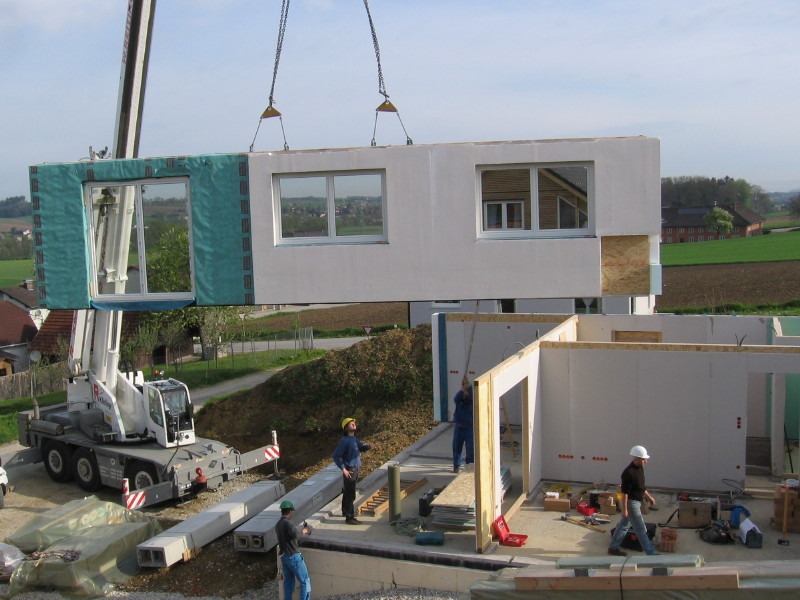

# BIM e inovação: o que deve chegar à operação do condomínio

BIM pode apoiar a organização das informações do edifício. Veja o que pedir na entrega da obra para conectar projeto, documentação e manutenção condominial.

**Redação Patri Realty · Apuração em 22/10/2026 · Rascunho**

Construção de casa pré-fabricada. Foto de contexto; não comprova adoção de BIM nesta obra.

Foto: H. Raab (User:Vesta) / Wikimedia Commons · CC BY-SA 3.0 · registro 2006-05-02

Origem: https://commons.wikimedia.org/wiki/File:Prefabricated_house_construction.jpg · Licença: http://creativecommons.org/licenses/by-sa/3.0/

Sem alteração editorial. Miniatura redimensionada pelo Wikimedia Commons, quando fornecida.

## Em poucas palavras

BIM reúne processos e informações para representar e acompanhar um empreendimento. Para o futuro condomínio, o valor está na entrega de dados utilizáveis: equipamentos identificados, documentos acessíveis e registros coerentes com o que foi construído. Um modelo tridimensional sem atualização ou rotina de uso não resolve, sozinho, a manutenção.

## A inovação precisa sobreviver à entrega das chaves

Um comprador costuma conhecer a apresentação visual do projeto antes de conhecer seus documentos operacionais. Nossa proposta é antecipar a pergunta: o que a equipe de gestão receberá e conseguirá usar depois da entrega?

A Estratégia BIM BR, reorganizada pelo Decreto 11.888/2024, busca disseminar o uso de BIM no país. Isso contextualiza a política pública, mas não significa que todo condomínio privado esteja obrigado por esse decreto a adotar a metodologia. [1](https://www.planalto.gov.br/ccivil_03/_ato2023-2026/2024/decreto/d11888.htm)[2](https://www.gov.br/obrasgov/pt-br/bim-obras-publicas/atuacao-do-mgi-na-estrategia-bim-br)

## O que pedir no pacote de informações

Como lista de negociação, recomendamos cadastro de sistemas, identificação de equipamentos, manuais, garantias e histórico de alterações. Os documentos precisam ter responsáveis, versões e formatos definidos. O conteúdo exato da entrega depende das obrigações aplicáveis e do contrato; a lista aqui é um roteiro editorial de avaliação.

Pergunte como a documentação será atualizada após reformas e substituições. Defina quem terá acesso e como o condomínio recuperará os arquivos se trocar de prestador. A dependência de uma conta pessoal ou de um fornecedor pode comprometer a continuidade do registro.

## BIM, pré-fabricação e gêmeo digital não são sinônimos

A pré-fabricação organiza componentes produzidos antes da montagem no local; BIM diz respeito à gestão das informações e aos processos de modelagem. É possível discutir os dois na mesma obra, mas uma fotografia de montagem não comprova como a informação foi gerida. A foto desta pauta ilustra construção pré-fabricada.

Também recomendamos cautela ao anunciar um gêmeo digital. Um modelo estático não demonstra, por si, conexão atualizada com a operação. Peça uma demonstração do uso proposto: localizar um ativo, consultar seu documento e registrar uma intervenção. As diferenças ficam mais claras em uma tarefa do que em uma promessa comercial.

## Uma prova simples antes de contratar

Escolha um equipamento representativo e peça que a equipe percorra todo o caminho: identificação, dados técnicos, acesso à documentação e exportação do registro. Verifique o que é entregue ao contratante e o que depende de licença ou assinatura.

Nosso critério editorial para inovação é utilidade demonstrável. Este texto não atribui percentuais de redução de custo ou prazo à adoção de BIM. Para afirmar esses ganhos em uma obra, seriam necessários método, base de comparação e resultados daquela aplicação.

## Perguntas frequentes

### BIM é apenas um desenho em 3D?

Não. A Estratégia BIM BR trata de modelagem da informação e de sua disseminação na construção. Uma avaliação de contratação deve olhar processos, dados e entregáveis, além da visualização.

### O decreto obriga todo condomínio privado a usar BIM?

Não. O Decreto 11.888/2024 institui a Estratégia BIM BR; não deve ser apresentado como obrigação universal para todos os condomínios privados.

### O síndico precisa operar um software de projeto?

Depende do arranjo contratado. A entrega deve prever acesso utilizável às informações e responsabilidades claras, sem pressupor que o síndico seja modelador.

## Verbetes

**Interoperabilidade** — Capacidade de diferentes sistemas trocarem e utilizarem informações, dentro de formatos e regras definidos.

**As built** — Registro da situação construída; sua utilidade depende da fidelidade e da atualização.

**Gêmeo digital** — Representação digital associada ao ativo e à operação; o termo exige esclarecer conexões, dados e atualização efetivamente disponíveis.

## Fontes consultadas em 22/10/2026

- [Decreto 11.888/2024 — Estratégia BIM BR](https://www.planalto.gov.br/ccivil_03/_ato2023-2026/2024/decreto/d11888.htm)

- [MGI — atuação na Estratégia BIM BR](https://www.gov.br/obrasgov/pt-br/bim-obras-publicas/atuacao-do-mgi-na-estrategia-bim-br)

## Continue a leitura

- [Gestão condominial de alto padrão: o luxo da previsibilidade](gestao-condominial-alto-padrao.md)

- [Bosco Verticale: o que avaliar em um empreendimento sustentável](bosco-verticale-empreendimentos-sustentaveis.md)

- [Sustentabilidade em condomínios: por onde começar](sustentabilidade-condominios-plano-pratico.md)

## Kit de publicação

**Título SEO:** BIM e inovação: da obra à gestão do condomínio

**Meta description:** BIM pode apoiar a organização das informações do edifício. Veja o que pedir na entrega da obra para conectar projeto, documentação e manutenção condominial.

**Slug:** bim-construcao-inovacao-condominios

**Buscas:** BIM condomínio, inovação na construção, entrega de obra manutenção

**Intenção:** Informacional; comparação e diligência antes da decisão

**Legenda social:** Inovação que termina na apresentação deixa pouco para a rotina do edifício. Veja quais informações pedir na entrega da obra e como avaliar BIM, documentação e manutenção em uma demonstração prática.
