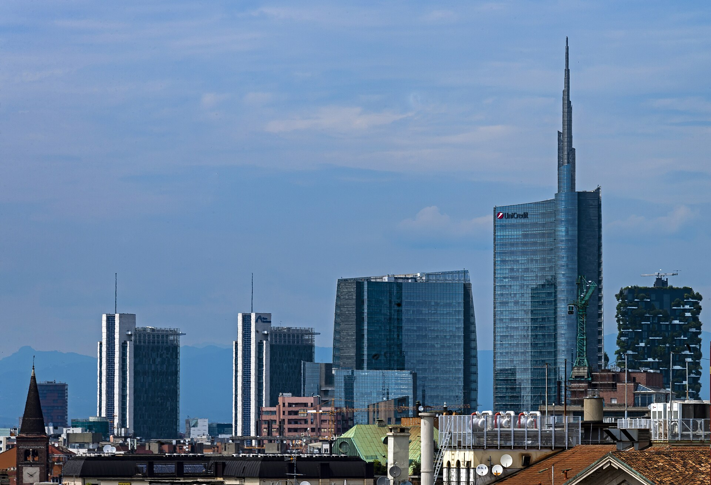

# Bosco Verticale: o que avaliar em um empreendimento sustentável

O Bosco Verticale, em Milão, ajuda a discutir vegetação, manutenção e desempenho. Saiba distinguir uma arquitetura verde de resultados ambientais comprovados.

**Redação Patri Realty · Apuração em 22/10/2026 · Rascunho**

Skyline de Milão com a Torre UniCredit e o Bosco Verticale. Foto de contexto urbano; o conjunto residencial foi concluído em 2014.

Foto: Daniel Case / Wikimedia Commons · CC BY-SA 3.0 · registro 2016-06-22

Origem: https://commons.wikimedia.org/wiki/File:Milan_skyline_with_Unicredit_Tower_and_Bosco_Verticale.jpg · Licença: https://creativecommons.org/licenses/by-sa/3.0

Sem alteração editorial. Miniatura redimensionada pelo Wikimedia Commons, quando fornecida.

## Em poucas palavras

O Bosco Verticale é um conjunto residencial de duas torres em Milão, concluído em 2014 e associado ao trabalho do Boeri Studio. Sua vegetação integrada à arquitetura é uma referência visual. Para avaliar um empreendimento sustentável, porém, é preciso examinar também energia, água, materiais, manutenção e evidências de desempenho.

## Uma referência existente, não um lançamento

O projeto é apresentado pelo escritório Stefano Boeri Architetti como uma experiência de integração entre edifícios e vegetação. A engenharia e as condições de implantação também aparecem na documentação da Tekne. Aqui, o Bosco Verticale funciona como estudo de caso: não como novidade imobiliária de 2026 nem como modelo automaticamente replicável no Brasil. [1](https://www.stefanoboeriarchitetti.net/en/project/vertical-forest)[2](https://www.teknespa.it/progetti/bosco-verticale)

Nossa leitura editorial é que a imagem de uma fachada plantada pode abrir uma conversa importante, mas não encerra a avaliação ambiental. Um comprador precisa saber como o conjunto funciona depois que a obra termina.

## Vegetação precisa de um plano de cuidado

Para examinar qualquer proposta semelhante, pergunte quem responde por irrigação, podas, substituição de espécies, acesso de manutenção e segurança do trabalho. Solicite a separação entre despesas das unidades e do condomínio.

Também vale pedir a justificativa de escolha das espécies para o clima e para a exposição da fachada. Estas são perguntas de diligência propostas pela Patri Realty. Não apresentamos uma auditoria independente do consumo ou do balanço de carbono do edifício italiano.

## Cinco dimensões para comparar projetos

Organize a comparação por energia, água, materiais, conforto e gestão. Em cada dimensão, busque uma informação verificável: projeto técnico, documento de ensaio, etiqueta, certificação ou medição operacional. Se a evidência estiver limitada ao material comercial, registre essa limitação.

No Brasil, a Certificação GBC Brasil Condomínio oferece uma referência específica para empreendimentos residenciais. A etiqueta do PBE Edifica trata de eficiência energética por seus próprios procedimentos. Certificação ambiental e etiqueta energética têm escopos diferentes; uma não deve ser anunciada como se fosse a outra. [3](https://www.gbcbrasil.org.br/certificacao/certificacao-condominio/)[4](https://www.gov.br/inmetro/pt-br/assuntos/regulamentacao/avaliacao-da-conformidade/programa-brasileiro-de-etiquetagem/tabelas-de-eficiencia-energetica/edificacoes)

## O que exigir antes de aceitar o adjetivo sustentável

Peça o nome do sistema de avaliação, o empreendimento abrangido, o estágio do processo e o documento correspondente. Uma intenção de certificar não equivale a certificação concedida. Para desempenho operacional, peça período, área considerada e método de cálculo.

Nossa recomendação é comparar projetos com uma ficha comum, inclusive quando um deles tem mais apelo visual. A pergunta decisiva é quais resultados podem ser conferidos e quais obrigações o proprietário e o condomínio assumirão para manter a proposta ao longo do tempo.

## Perguntas frequentes

### O Bosco Verticale é um lançamento?

Não. O conjunto em Milão foi concluído em 2014 e aparece nesta pauta como caso de arquitetura com vegetação integrada.

### Uma fachada verde comprova sustentabilidade?

Sozinha, não. É preciso conhecer projeto, manutenção e resultados, além do escopo de eventuais certificações.

### Uma certificação elimina a manutenção?

Não. Sistemas e práticas precisam de operação e conservação compatíveis com o projeto; verifique obrigações e custos antes da compra.

## Verbetes

**Desempenho operacional** — Resultado observado no uso do edifício, distinto de uma estimativa de projeto.

**Greenwashing** — Apresentação ambiental enganosa ou desproporcional às evidências disponíveis.

**Escopo de certificação** — Conjunto de critérios, etapas e limites efetivamente cobertos pela avaliação.

## Fontes consultadas em 22/10/2026

- [Stefano Boeri Architetti — Vertical Forest](https://www.stefanoboeriarchitetti.net/en/project/vertical-forest)

- [Tekne — Bosco Verticale](https://www.teknespa.it/progetti/bosco-verticale)

- [GBC Brasil — Certificação Condomínio](https://www.gbcbrasil.org.br/certificacao/certificacao-condominio/)

- [Inmetro — PBE Edifica](https://www.gov.br/inmetro/pt-br/assuntos/regulamentacao/avaliacao-da-conformidade/programa-brasileiro-de-etiquetagem/tabelas-de-eficiencia-energetica/edificacoes)

## Continue a leitura

- [Sustentabilidade em condomínios: por onde começar](sustentabilidade-condominios-plano-pratico.md)

- [BIM e inovação: o que deve chegar à operação do condomínio](bim-construcao-inovacao-condominios.md)

- [Almaz no Ibirapuera: como avaliar um lançamento de alto padrão](almaz-ibirapuera-lancamento-alto-padrao.md)

## Kit de publicação

**Título SEO:** Bosco Verticale e os empreendimentos sustentáveis

**Meta description:** O Bosco Verticale, em Milão, ajuda a discutir vegetação, manutenção e desempenho. Saiba distinguir uma arquitetura verde de resultados ambientais comprovados.

**Slug:** bosco-verticale-empreendimentos-sustentaveis

**Buscas:** empreendimentos sustentáveis, Bosco Verticale Milão, certificação condomínio sustentável

**Intenção:** Informacional; comparação e diligência antes da decisão

**Legenda social:** Uma fachada verde chama atenção. O desempenho pede evidência. A partir do Bosco Verticale, reunimos perguntas sobre água, energia, manutenção e certificação para quem avalia um imóvel sustentável.
