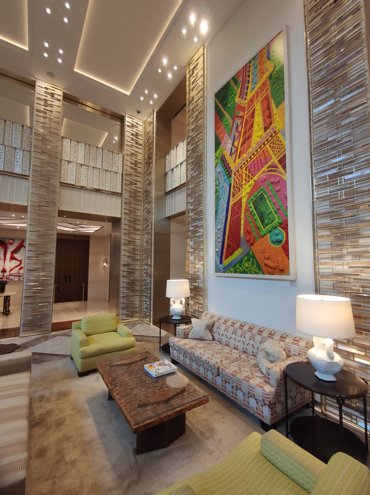

# Cheval Blanc Paris: três Chaves Michelin junto ao Sena

No endereço da Samaritaine, o Cheval Blanc Paris reúne hospitalidade e localização central. Conheça o perfil e as perguntas úteis antes da reserva.

**Redação Patri Realty · Apuração em 22/10/2026 · Rascunho**

Lobby do Cheval Blanc Paris. Fotografia de arquivo; ambientação e operação podem mudar.

Foto: CVB / Wikimedia Commons · CC BY-SA 4.0 · registro 2023-05-12 14:42:33

Origem: https://commons.wikimedia.org/wiki/File:Cheval_Blanc_lobby_Paris.jpg · Licença: https://creativecommons.org/licenses/by-sa/4.0

Sem alteração editorial. Miniatura redimensionada pelo Wikimedia Commons, quando fornecida.

## Em poucas palavras

O Cheval Blanc Paris é um hotel com três Chaves Michelin, instalado no conjunto da Samaritaine, junto ao Sena, em Paris. O endereço interessa a quem procura uma base urbana de alto padrão. Antes de reservar, compare a categoria da acomodação, os serviços incluídos e as condições aplicáveis às datas escolhidas.

## Paris como parte da experiência

A ficha Michelin localiza o hotel no Quai du Louvre e descreve sua implantação na antiga Samaritaine, com 72 quartos e suítes. O Dior Spa é outro componente apresentado na proposta de hospedagem. Esses dados ajudam a definir o perfil do endereço sem substituir uma avaliação da categoria de quarto pretendida. [1](https://guide.michelin.com/en/hotels-stays/paris/cheval-blanc-paris-dior-spa-cheval-blanc-paris-12286)

Nossa leitura editorial é que, em um hotel urbano, a relação com a cidade merece tanto cuidado quanto a decoração. Para o seu roteiro, estime os deslocamentos que realmente pretende fazer e o tempo que deseja permanecer na propriedade.

## O que comparar entre categorias

Como roteiro de reserva, peça área, configuração de camas, localização no edifício e características da vista da categoria cotada. Não presuma que uma foto de suíte represente todas as acomodações. Pergunte sobre acessibilidade e configurações familiares quando isso fizer parte da viagem.

Consulte o canal oficial para saber o que está incluído na tarifa: alimentação, uso de serviços, eventuais benefícios e despesas adicionais. Diferentes condições comerciais não devem ser comparadas apenas pelo preço da noite. O site da maison é o ponto de partida para informações atualizadas. [2](https://www.chevalblanc.com/en/maison/paris/)

## Três Chaves não escolhem o roteiro por você

A distinção é um dado de avaliação do guia, não uma garantia de que o endereço seja ideal para todos os viajantes. Nossa sugestão é decidir se a prioridade é estar em um hotel urbano, circular pela cidade ou dedicar parte do dia à própria hospedagem. Essa preferência muda a maneira de avaliar o valor da estadia.

Para quem acompanha o mercado imobiliário de alto padrão, o caso também abre uma pauta sobre reuso de edifícios e transformação de endereços urbanos. Trata-se de uma conexão editorial, não de uma equivalência entre comprar um imóvel e contratar uma experiência de hotel.

## Antes de confirmar

Confira cancelamento, forma de pagamento, impostos ou encargos informados no orçamento e pedidos especiais. Uma solicitação enviada não equivale a confirmação de atendimento. Guarde a proposta e a reserva emitida pelo canal contratado.

A fotografia mostra parte do lobby em registro de arquivo. O artigo é documental e não descreve uma visita da redação. Não informamos diária ou disponibilidade em tempo real.

## Perguntas frequentes

### Onde fica o Cheval Blanc Paris?

No Quai du Louvre, em Paris, junto ao Sena e ao conjunto da Samaritaine. Consulte o endereço completo na ficha oficial antes do deslocamento.

### Qual é a distinção Michelin do hotel?

Três Chaves, conforme a ficha consultada em 22 de outubro de 2026. A distinção de hotel é separada das Estrelas atribuídas a restaurantes.

### A diária inclui todos os serviços?

Não presuma essa inclusão. O orçamento da categoria e das datas escolhidas deve detalhar serviços, benefícios e cobranças adicionais.

## Verbetes

**Categoria de acomodação** — Tipo específico de quarto ou suíte; fotos e benefícios de outra categoria não se transferem automaticamente.

**Reuso adaptativo** — Adaptação de uma edificação existente para uma nova função, respeitadas as condições do projeto.

**Concierge** — Serviço de apoio ao hóspede; o escopo e as condições devem ser confirmados com o hotel.

## Fontes consultadas em 22/10/2026

- [Michelin — ficha do Cheval Blanc Paris](https://guide.michelin.com/en/hotels-stays/paris/cheval-blanc-paris-dior-spa-cheval-blanc-paris-12286)

- [Cheval Blanc Paris — site oficial](https://www.chevalblanc.com/en/maison/paris/)

## Continue a leitura

- [Guia Michelin: seis endereços para uma viagem de alto padrão](guia-michelin-hoteis-restaurantes-selecao.md)

- [Passalacqua: três Chaves Michelin no Lago de Como](passalacqua-lago-como-tres-chaves.md)

- [Hôtel du Cap-Eden-Roc: três Chaves na Riviera Francesa](hotel-du-cap-eden-roc-tres-chaves.md)

## Kit de publicação

**Título SEO:** Cheval Blanc Paris: hotel com três Chaves Michelin

**Meta description:** No endereço da Samaritaine, o Cheval Blanc Paris reúne hospitalidade e localização central. Conheça o perfil e as perguntas úteis antes da reserva.

**Slug:** cheval-blanc-paris-tres-chaves

**Buscas:** Cheval Blanc Paris, hotel três Chaves Michelin Paris, hotel de luxo Sena

**Intenção:** Informacional e planejamento de viagem; consulta aos canais oficiais

**Legenda social:** Paris como endereço, o Sena como contexto. Conheça o perfil do Cheval Blanc Paris, distinguido com três Chaves Michelin, e as perguntas que ajudam a comparar acomodações e condições de reserva.
