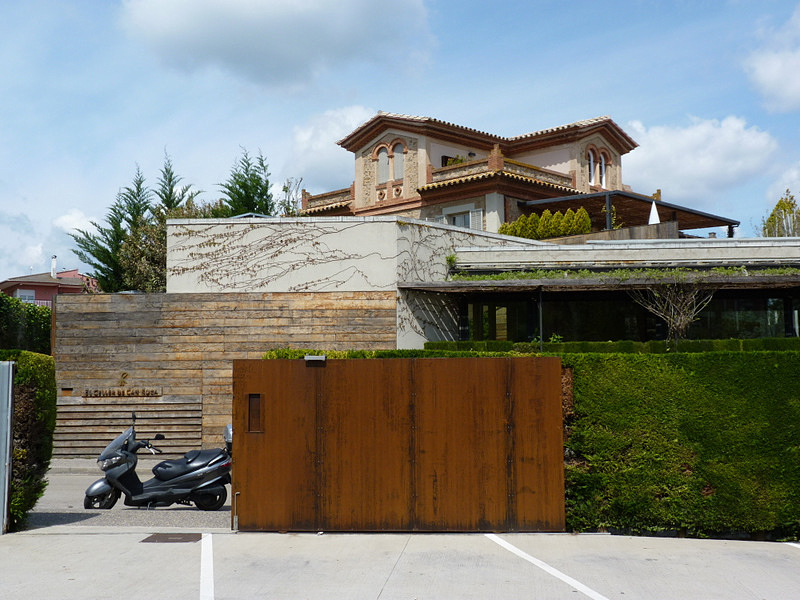

# El Celler de Can Roca: três Estrelas Michelin em Girona

A casa dos irmãos Roca reúne cozinha, vinho e confeitaria em Girona. Conheça seu perfil e os cuidados para organizar uma reserva gastronômica.

**Redação Patri Realty · Apuração em 22/10/2026 · Rascunho**

Exterior do El Celler de Can Roca, em Girona. Fotografia de arquivo.

Foto: e_calamar / Wikimedia Commons · CC BY 2.0 · registro 2012-04-14 12:46:31

Origem: https://commons.wikimedia.org/wiki/File:El_Celler_de_Can_Roca_exterior.jpg · Licença: https://creativecommons.org/licenses/by/2.0

Sem alteração editorial. Miniatura redimensionada pelo Wikimedia Commons, quando fornecida.

## Em poucas palavras

O El Celler de Can Roca fica em Girona, na Catalunha, Espanha, e tem três Estrelas Michelin. A casa está associada aos irmãos Joan, Josep e Jordi Roca, em frentes de cozinha, vinho e sobremesas. Para planejar a visita, confirme a reserva no canal oficial e organize o deslocamento até o endereço correto.

## Três especialidades em um mesmo endereço

A ficha do Michelin apresenta o restaurante na Carrer de Can Sunyer e destaca a complementaridade do trabalho dos irmãos Roca. O site oficial é a referência para a identidade da casa e seus canais de contato. A distinção gastronômica sustenta esta escolha editorial, sem criar uma posição em ranking mundial. [1](https://guide.michelin.com/en/catalunya/girona/restaurant/el-celler-de-can-roca)[2](https://cellercanroca.com/en/)

Nossa leitura é que a relação entre cozinha, vinho e sobremesas pode orientar as perguntas de quem planeja a experiência. Vale discutir previamente o interesse do grupo, inclusive quando alguém não consome bebidas alcoólicas.

## Girona pede uma logística própria

Não confunda o restaurante com um endereço em Barcelona nem com outros negócios ligados ao mesmo grupo. Use o nome completo e o endereço da confirmação para planejar transporte e chegada. Uma marca conhecida pode ter mais de uma operação, com propostas e reservas distintas.

Como orientação de viagem, recomendamos deixar margem entre deslocamentos e compromissos. Confirme com o canal oficial o formato de atendimento na data pretendida, os horários aplicáveis e as condições para alterações. Não apresentamos tempo universal de espera ou disponibilidade em tempo real.

## O que perguntar antes de escolher o percurso

Peça informações sobre a proposta de menu vigente, possibilidades para restrições alimentares e opções de bebidas. Se houver harmonização, confirme o que está incluído e como ela se relaciona com o menu escolhido. Estes são pontos de planejamento, não uma descrição de itens garantidos em toda reserva.

A pesquisa documental permite contextualizar o endereço e sua distinção. Não permite à Patri Realty atribuir uma nota própria ao serviço ou às preparações. O leitor encontrará aqui uma curadoria e um roteiro de verificação, sem resenha presencial inventada.

## Uma reserva organizada preserva a experiência

Confira quantidade de pessoas, contato para mudanças, pagamento e política vigente. Avise necessidades com antecedência e aguarde resposta, em vez de presumir adaptação automática. Mantenha a confirmação acessível durante a viagem.

A fotografia do exterior foi feita em 2012. É um registro de arquivo usado para identificar o restaurante, não uma imagem atual do salão ou do menu. A ficha Michelin e o site da casa estão vinculados para conferência direta.

## Perguntas frequentes

### O El Celler de Can Roca fica em Barcelona?

Não. O restaurante fica em Girona, na Catalunha. Planeje o deslocamento usando o endereço da confirmação.

### Qual é a participação dos irmãos Roca?

A casa associa Joan à cozinha, Josep ao vinho e Jordi às sobremesas, conforme as fontes oficiais consultadas.

### A reserva de outro negócio dos Roca vale para esta casa?

Não presuma equivalência. Confirme nome completo, endereço e serviço contratado no documento de reserva.

## Verbetes

**Harmonização** — Seleção de bebidas proposta para acompanhar um percurso gastronômico; escopo e preço precisam ser confirmados.

**Sommelier** — Profissional ligado à seleção e ao serviço de bebidas, especialmente vinhos.

**Percurso gastronômico** — Sequência organizada de preparações; não é uma categoria de distinção Michelin.

## Fontes consultadas em 22/10/2026

- [Michelin — El Celler de Can Roca](https://guide.michelin.com/en/catalunya/girona/restaurant/el-celler-de-can-roca)

- [El Celler de Can Roca — site oficial](https://cellercanroca.com/en/)

- [Michelin — lista da Espanha 2026](https://guide.michelin.com/gb/en/article/michelin-guide-ceremony/all-michelin-star-restaurants-in-spain-2026-the-full-list)

## Continue a leitura

- [Guia Michelin: seis endereços para uma viagem de alto padrão](guia-michelin-hoteis-restaurantes-selecao.md)

- [Osteria Francescana: três Estrelas Michelin em Modena](osteria-francescana-modena-tres-estrelas.md)

- [Le Louis XV: três Estrelas Michelin em Mônaco](le-louis-xv-monaco-tres-estrelas.md)

## Kit de publicação

**Título SEO:** El Celler de Can Roca: três Estrelas em Girona

**Meta description:** A casa dos irmãos Roca reúne cozinha, vinho e confeitaria em Girona. Conheça seu perfil e os cuidados para organizar uma reserva gastronômica.

**Slug:** el-celler-de-can-roca-girona-tres-estrelas

**Buscas:** El Celler de Can Roca Girona, irmãos Roca restaurante, três Estrelas Michelin Espanha

**Intenção:** Informacional e planejamento de viagem; consulta aos canais oficiais

**Legenda social:** Cozinha, vinho e sobremesas em um mesmo projeto familiar. O El Celler de Can Roca integra nossa curadoria de três Estrelas Michelin. Veja o perfil da casa e como organizar a visita a Girona.
