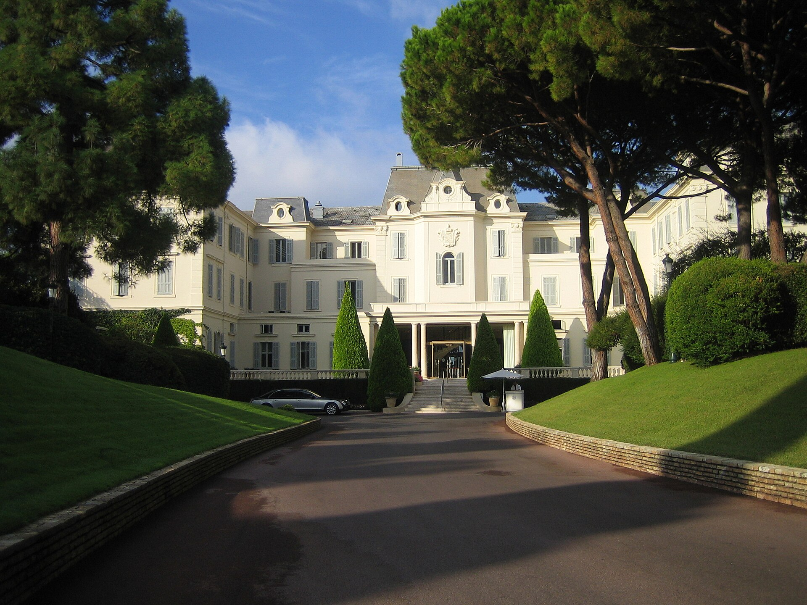

# Hôtel du Cap-Eden-Roc: três Chaves na Riviera Francesa

Em Antibes, o Hôtel du Cap-Eden-Roc integra a seleção máxima de Chaves Michelin. Conheça o perfil e a importância de conferir o calendário sazonal.

**Redação Patri Realty · Apuração em 22/10/2026 · Rascunho**

Fachada do Hôtel du Cap-Eden-Roc, em Antibes. Fotografia de arquivo.

Foto: John Jason Junior / Wikimedia Commons · CC BY-SA 3.0 · registro 2011-09-12

Origem: https://commons.wikimedia.org/wiki/File:Hauptfassade_Hotel_Du_Cap.jpg · Licença: https://creativecommons.org/licenses/by-sa/3.0

Sem alteração editorial. Miniatura redimensionada pelo Wikimedia Commons, quando fornecida.

## Em poucas palavras

O Hôtel du Cap-Eden-Roc fica em Antibes, na Riviera Francesa, e tem três Chaves Michelin. Sua proposta reúne uma propriedade arborizada e relação direta com o litoral. A operação é sazonal: antes de organizar uma viagem em torno do hotel, confirme o calendário vigente e a disponibilidade da acomodação desejada.

## Um endereço em que o terreno importa

O Michelin destaca os jardins, a implantação junto ao mar e a piscina escavada na rocha entre os elementos do endereço. A ficha também apresenta opções de acomodação e serviços que compõem a experiência da propriedade. Usamos esses elementos para contextualizar o perfil, sem atribuir uma experiência pessoal à redação. [1](https://guide.michelin.com/us/en/hotels-stays/antibes/hotel-du-cap-eden-roc-13557)

Nossa leitura editorial é que, em uma hospedagem desse tipo, o terreno e o tempo de permanência participam da decisão. Se a viagem será intensa em deslocamentos, avalie quanto da proposta do hotel você pretende de fato aproveitar.

## O calendário vem antes do orçamento

O site oficial informa funcionamento sazonal e, na consulta de 22 de outubro de 2026, anuncia a temporada seguinte entre 18 de abril e 17 de outubro de 2027. Trate essas datas como calendário anunciado, sujeito à confirmação pelo hotel; não como prova de reserva disponível. [2](https://www.oetkerhotels.com/hotels/hotel-du-cap-eden-roc/)

Antes de comprar passagens, confirme a abertura para o período desejado e as condições da categoria cotada. Pergunte quais instalações e serviços estarão operando e o que depende de contratação específica ou de condições locais.

## Compare o uso da propriedade, não apenas a foto

Como roteiro de escolha, recomendamos perguntar sobre posição da acomodação, circulação até os espaços de interesse, acessibilidade e necessidades da família. Não transfira a configuração de uma villa para um quarto ou uma suíte apenas porque todos estão no mesmo endereço.

Também vale detalhar refeições, transporte e eventuais serviços extras no orçamento total. A distinção Michelin ajuda a situar a proposta, mas não informa sozinha a conta final nem as condições de cancelamento.

## O que esta seleção afirma

O hotel aparece nesta série por estar na faixa máxima de Chaves e representar uma proposta de hospitalidade costeira distinta dos outros dois endereços escolhidos. Isso não constitui um ranking universal de melhores hotéis.

A fotografia da fachada é de arquivo, de 2011. Ela identifica a propriedade e não confirma a configuração atual de serviços. Não publicamos número de quartos: as fontes consultadas usam contagens diferentes, sem base suficiente para harmonizá-las nesta pauta.

## Perguntas frequentes

### O Hôtel du Cap-Eden-Roc abre o ano inteiro?

O site oficial apresenta operação sazonal. Consulte o calendário atualizado antes de organizar a viagem.

### Qual é a distinção Michelin?

Três Chaves, conforme a ficha consultada em 22 de outubro de 2026.

### Há disponibilidade nas datas anunciadas?

O anúncio de uma temporada não comprova disponibilidade de uma categoria. Apenas a cotação e a confirmação do hotel resolvem essa questão.

## Verbetes

**Operação sazonal** — Funcionamento concentrado em períodos do ano; serviços e datas devem ser confirmados.

**Categoria de villa** — Modalidade de acomodação cuja configuração e condições não se presumem iguais às de quartos e suítes.

**Calendário anunciado** — Período de funcionamento divulgado pelo operador; não equivale a uma reserva confirmada.

## Fontes consultadas em 22/10/2026

- [Michelin — ficha do Hôtel du Cap-Eden-Roc](https://guide.michelin.com/us/en/hotels-stays/antibes/hotel-du-cap-eden-roc-13557)

- [Oetker Hotels — site oficial](https://www.oetkerhotels.com/hotels/hotel-du-cap-eden-roc/)

## Continue a leitura

- [Guia Michelin: seis endereços para uma viagem de alto padrão](guia-michelin-hoteis-restaurantes-selecao.md)

- [Cheval Blanc Paris: três Chaves Michelin junto ao Sena](cheval-blanc-paris-tres-chaves.md)

- [Passalacqua: três Chaves Michelin no Lago de Como](passalacqua-lago-como-tres-chaves.md)

## Kit de publicação

**Título SEO:** Hôtel du Cap-Eden-Roc: três Chaves na Riviera

**Meta description:** Em Antibes, o Hôtel du Cap-Eden-Roc integra a seleção máxima de Chaves Michelin. Conheça o perfil e a importância de conferir o calendário sazonal.

**Slug:** hotel-du-cap-eden-roc-tres-chaves

**Buscas:** Hôtel du Cap Eden Roc, hotel três Chaves Antibes, hotel luxo Riviera Francesa

**Intenção:** Informacional e planejamento de viagem; consulta aos canais oficiais

**Legenda social:** Na Riviera Francesa, a escolha também passa pelo calendário. Conheça o Hôtel du Cap-Eden-Roc, com três Chaves Michelin, e os cuidados para planejar uma estadia sazonal em Antibes.
