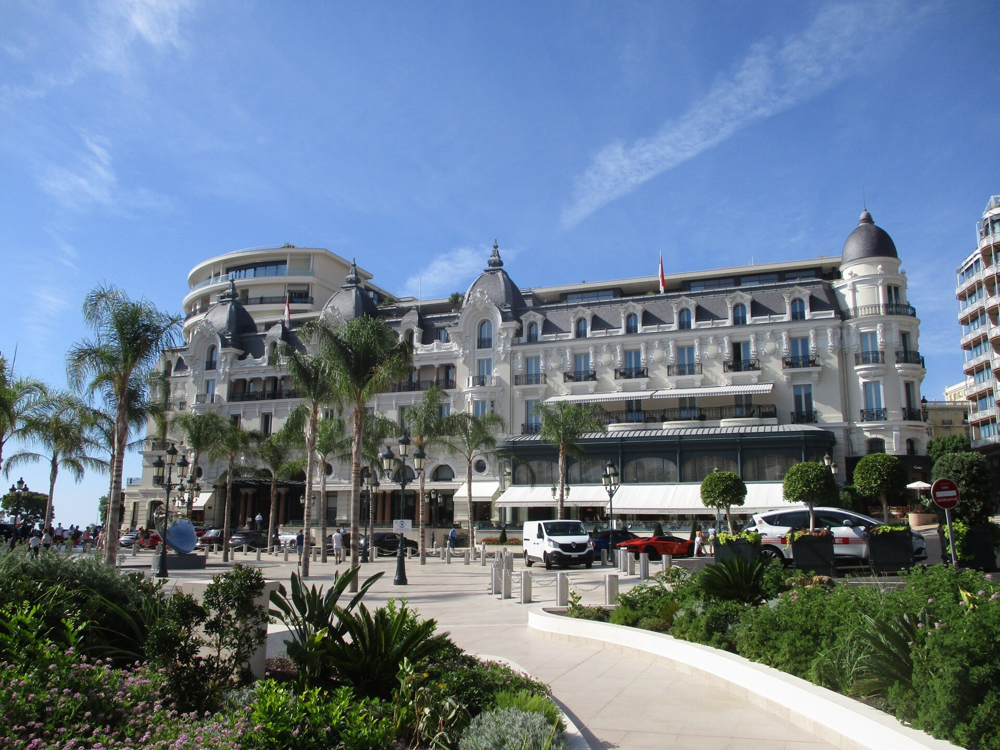

# Le Louis XV: três Estrelas Michelin em Mônaco

No Hôtel de Paris Monte-Carlo, o Le Louis XV leva a assinatura de Alain Ducasse e a cozinha de Emmanuel Pilon. Conheça o perfil e os canais oficiais.

**Redação Patri Realty · Apuração em 22/10/2026 · Rascunho**

Hôtel de Paris Monte-Carlo, endereço do Le Louis XV. Foto externa de contexto; não mostra o salão do restaurante.

Foto: Arnaud 25 / Wikimedia Commons · CC BY-SA 4.0 · registro 2020-08-26 10:39:30

Origem: https://commons.wikimedia.org/wiki/File:H%C3%B4tel_de_Paris_Monte-Carlo_001.jpg · Licença: https://creativecommons.org/licenses/by-sa/4.0

Sem alteração editorial. Miniatura redimensionada pelo Wikimedia Commons, quando fornecida.

## Em poucas palavras

O Le Louis XV – Alain Ducasse à l’Hôtel de Paris fica na Place du Casino, em Mônaco, e tem três Estrelas Michelin. O guia associa a execução atual da cozinha a Emmanuel Pilon e a assinatura a Alain Ducasse. A inspiração mediterrânea orienta o perfil, sem dispensar a consulta ao menu e às condições da reserva.

## Um restaurante dentro de um hotel, com distinção própria

O nome completo é importante: esta pauta trata do Le Louis XV, situado no Hôtel de Paris Monte-Carlo. O Michelin descreve uma cozinha ligada ao Mediterrâneo e identifica Emmanuel Pilon no trabalho associado a Alain Ducasse. O site Ducasse Paris confirma o endereço e oferece o caminho oficial de reserva. [1](https://guide.michelin.com/gb/en/monaco-region/monaco/restaurant/le-louis-xv-alain-ducasse-a-l-hotel-de-paris)[2](https://www.ducasse-paris.com/en/addresses/le-louis-xv-alain-ducasse-a-lhotel-de-paris/)

Nossa leitura editorial é que a combinação entre restaurante e hotel pode facilitar um roteiro, mas não autoriza presumir que reservar um serviço inclua o outro. Confirme cada contratação separadamente.

## O Mediterrâneo como referência, não um menu fixo

A inspiração da Riviera aparece na apresentação oficial. Isso ajuda a situar a proposta culinária, mas não permite anunciar um prato específico como disponível em qualquer data. Para restrições alimentares e preferências, consulte diretamente a equipe de reservas. [2](https://www.ducasse-paris.com/en/addresses/le-louis-xv-alain-ducasse-a-lhotel-de-paris/)

Não descrevemos sabor, textura ou atendimento como se a redação tivesse realizado uma refeição. A curadoria se apoia na distinção do guia e nas informações institucionais. A adequação ao gosto de cada viajante continua sendo uma decisão individual.

## O que confirmar antes de organizar a noite

Pergunte sobre menu vigente, duração esperada, vestimenta solicitada, acessibilidade e condições para o grupo. Verifique o endereço da confirmação e planeje a chegada de acordo com a sua hospedagem. São pontos sugeridos para planejamento, sem afirmar que exista uma mesma exigência para todas as reservas.

Também é prudente discriminar alimentação, bebidas e despesas adicionais no orçamento. Uma proposta de harmonização pode ter condições próprias. Solicite as regras de pagamento, alteração e cancelamento do serviço efetivamente escolhido.

## Por que entra na curadoria da Patri Realty

O endereço completa o recorte com uma proposta mediterrânea em Mônaco, ao lado das referências de Modena e Girona. Os três restaurantes compartilham a faixa máxima de Estrelas nesta seleção, mas não são apresentados em ordem de superioridade. [3](https://www.michelin.com/en/publications/products-and-services/new-selection-michelin-guide-france-monaco-2026)

A foto é do exterior do Hôtel de Paris, feita em 2020, e não do salão do Le Louis XV. É uma imagem de contexto devidamente identificada. Não usamos fotografias de pratos retiradas de reportagens sem licença, nem atribuímos ao restaurante uma avaliação própria da Patri Realty.

## Perguntas frequentes

### Quem está à frente da cozinha mencionada pelo guia?

A ficha consultada identifica Emmanuel Pilon no trabalho ligado à assinatura de Alain Ducasse. A informação foi verificada em 22 de outubro de 2026.

### O Le Louis XV fica na França?

O restaurante fica em Mônaco, na Place du Casino, dentro do Hôtel de Paris Monte-Carlo.

### A reserva do hotel inclui a do restaurante?

Não presuma essa inclusão. Confirme disponibilidade e condições do restaurante em seu próprio canal de reserva.

## Verbetes

**Assinatura culinária** — Identidade e direção associadas à proposta de um chef; não significa que ele cozinhe pessoalmente em toda sessão.

**Riviera** — Referência geográfica e cultural ao litoral mediterrâneo presente na apresentação oficial da casa.

**Reserva confirmada** — Contratação validada pelo canal responsável, com data, quantidade de pessoas e condições identificadas.

## Fontes consultadas em 22/10/2026

- [Michelin — Le Louis XV](https://guide.michelin.com/gb/en/monaco-region/monaco/restaurant/le-louis-xv-alain-ducasse-a-l-hotel-de-paris)

- [Ducasse Paris — site oficial do endereço](https://www.ducasse-paris.com/en/addresses/le-louis-xv-alain-ducasse-a-lhotel-de-paris/)

- [Michelin — seleção França e Mônaco 2026](https://www.michelin.com/en/publications/products-and-services/new-selection-michelin-guide-france-monaco-2026)

## Continue a leitura

- [Guia Michelin: seis endereços para uma viagem de alto padrão](guia-michelin-hoteis-restaurantes-selecao.md)

- [Osteria Francescana: três Estrelas Michelin em Modena](osteria-francescana-modena-tres-estrelas.md)

- [El Celler de Can Roca: três Estrelas Michelin em Girona](el-celler-de-can-roca-girona-tres-estrelas.md)

## Kit de publicação

**Título SEO:** Le Louis XV: três Estrelas Michelin em Mônaco

**Meta description:** No Hôtel de Paris Monte-Carlo, o Le Louis XV leva a assinatura de Alain Ducasse e a cozinha de Emmanuel Pilon. Conheça o perfil e os canais oficiais.

**Slug:** le-louis-xv-monaco-tres-estrelas

**Buscas:** Le Louis XV Mônaco, Alain Ducasse Hôtel de Paris, Emmanuel Pilon três Estrelas

**Intenção:** Informacional e planejamento de viagem; consulta aos canais oficiais

**Legenda social:** Em Mônaco, a inspiração mediterrânea do Le Louis XV leva a assinatura de Alain Ducasse e o trabalho de Emmanuel Pilon. Conheça este endereço de três Estrelas Michelin e os cuidados antes de reservar.
