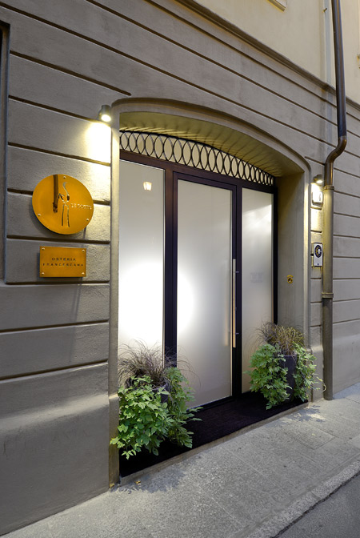

# Osteria Francescana: três Estrelas Michelin em Modena

A casa de Massimo Bottura integra nossa curadoria gastronômica. Conheça o perfil da Osteria Francescana e o que confirmar antes de reservar em Modena.

**Redação Patri Realty · Apuração em 22/10/2026 · Rascunho**

Entrada da Osteria Francescana, em Modena. Fotografia de arquivo.

Foto: Monchen / Wikimedia Commons · Public domain · registro 2009-04-30

Origem: https://commons.wikimedia.org/wiki/File:Osteria_francescana.jpg · Licença: https://commons.wikimedia.org/wiki/File:Osteria_francescana.jpg

Sem alteração editorial. Miniatura redimensionada pelo Wikimedia Commons, quando fornecida.

## Em poucas palavras

A Osteria Francescana é o restaurante de Massimo Bottura em Modena, na Itália, com três Estrelas Michelin. A proposta trabalha a cozinha italiana em linguagem contemporânea. Para organizar a visita, comece pelo canal oficial de reservas e confirme formato do menu, restrições alimentares e condições vigentes para a data pretendida.

## Por que entra nesta seleção

O Michelin situa a casa na Via Stella e associa sua cozinha ao trabalho de Massimo Bottura, com uma interpretação criativa do repertório italiano. A distinção de três Estrelas é a referência que sustenta a presença neste conjunto de três restaurantes. Não atribuímos à casa uma posição numérica mundial. [1](https://guide.michelin.com/en/emilia-romagna/modena/restaurant/osteria-francescana)

Nossa leitura editorial é que uma reserva gastronômica desse perfil merece espaço próprio no planejamento. Evite tratá-la apenas como intervalo entre deslocamentos: pense no tempo de chegada, no compromisso seguinte e no interesse de quem viaja com você.

## A experiência começa na confirmação da mesa

A FAQ oficial informa que o processo de reserva passa pelo site do restaurante e contempla lista de espera. Também apresenta formatos de menu que devem ser confirmados para a visita pretendida. Uma inscrição em espera não deve ser tratada como confirmação de mesa. [2](https://osteriafrancescana.it/faq/)

Nossa recomendação é guardar o e-mail de confirmação e revisar data, quantidade de pessoas e condições aceitas. Informe alergias e restrições antes da visita e peça confirmação explícita de atendimento; a mera indicação no pedido não resolve todas as necessidades.

## Como ler uma cozinha autoral sem inventar uma resenha

O repertório italiano e a interpretação contemporânea são o ponto de partida documental. A avaliação de sabores, ponto de cocção, ritmo do serviço ou harmonização exigiria uma experiência que esta redação não realizou. Por isso, não usamos notas próprias nem descrevemos sensações como se estivéssemos à mesa.

Para escolher, pergunte se o grupo procura um percurso definido pela cozinha ou maior liberdade de seleção. Confirme as opções atuais com o restaurante. Uma fotografia de prato publicada em outro momento não assegura que ele esteja no menu da sua data.

## O que conferir no orçamento e na logística

Peça as condições de pagamento, cancelamento e alteração da quantidade de pessoas. Verifique o que a proposta inclui e o que é cobrado à parte. Não publicamos um preço de menu que possa ser confundido com uma cotação válida para qualquer momento.

A imagem usada é uma fotografia de arquivo da entrada, de 2009. Ela identifica o endereço e não comprova a configuração atual do salão. Para informações operacionais, siga os links oficiais abaixo.

## Perguntas frequentes

### Onde fica a Osteria Francescana?

Em Modena, na Itália, na Via Stella. Consulte o endereço completo e a confirmação de reserva antes da visita.

### Quem é o chef associado ao restaurante?

Massimo Bottura, conforme a ficha do Guia Michelin consultada nesta apuração.

### Entrar na lista de espera garante uma mesa?

Não. Aguarde a confirmação formal pelo canal do restaurante e confira as condições da reserva emitida.

## Verbetes

**Cozinha autoral** — Proposta culinária reconhecível pelo repertório e pelas escolhas criativas de sua equipe.

**Menu degustação** — Sequência de preparações definida para uma experiência; composição e adaptações devem ser consultadas.

**Lista de espera** — Registro de interesse em eventual disponibilidade; não equivale a reserva confirmada.

## Fontes consultadas em 22/10/2026

- [Michelin — Osteria Francescana](https://guide.michelin.com/en/emilia-romagna/modena/restaurant/osteria-francescana)

- [Osteria Francescana — FAQ oficial](https://osteriafrancescana.it/faq/)

- [Michelin — seleção Itália 2026](https://www.michelin.com/en/publications/products-and-services/michelin-guide-italy-2026)

## Continue a leitura

- [Guia Michelin: seis endereços para uma viagem de alto padrão](guia-michelin-hoteis-restaurantes-selecao.md)

- [El Celler de Can Roca: três Estrelas Michelin em Girona](el-celler-de-can-roca-girona-tres-estrelas.md)

- [Le Louis XV: três Estrelas Michelin em Mônaco](le-louis-xv-monaco-tres-estrelas.md)

## Kit de publicação

**Título SEO:** Osteria Francescana: três Estrelas em Modena

**Meta description:** A casa de Massimo Bottura integra nossa curadoria gastronômica. Conheça o perfil da Osteria Francescana e o que confirmar antes de reservar em Modena.

**Slug:** osteria-francescana-modena-tres-estrelas

**Buscas:** Osteria Francescana Modena, Massimo Bottura restaurante, três Estrelas Michelin Itália

**Intenção:** Informacional e planejamento de viagem; consulta aos canais oficiais

**Legenda social:** Modena, Massimo Bottura e uma interpretação contemporânea da cozinha italiana. Conheça o perfil da Osteria Francescana e o que verificar antes de reservar uma das mesas desta curadoria Michelin.
