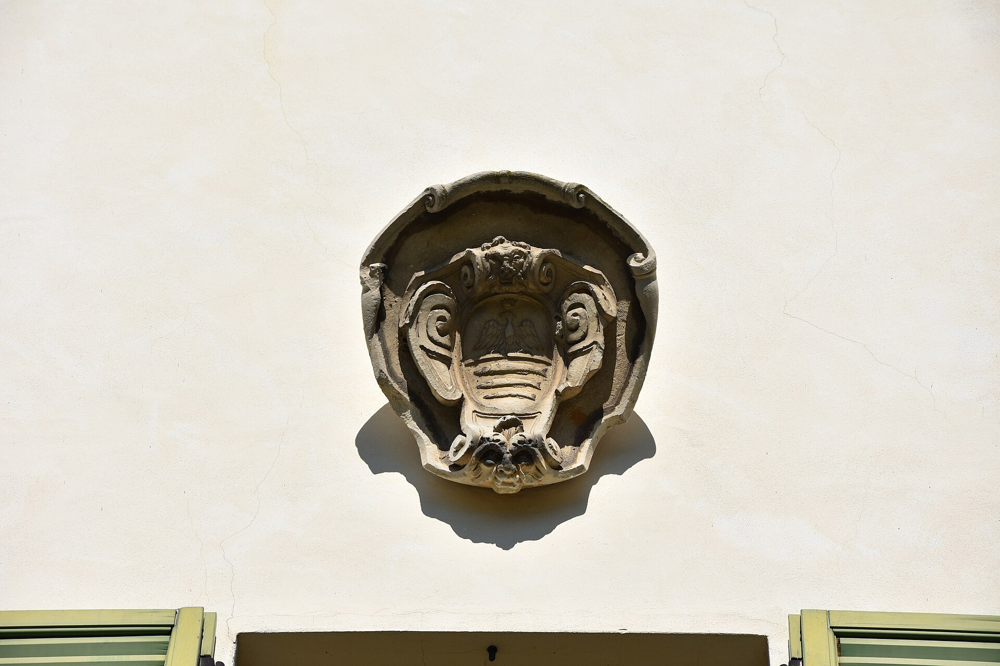

# Passalacqua: três Chaves Michelin no Lago de Como

Em Moltrasio, o Passalacqua transforma uma villa histórica em hotel de pequena escala. Veja o perfil e o que confirmar para planejar a estadia.

**Redação Patri Realty · Apuração em 22/10/2026 · Rascunho**

Villa Passalacqua, em Moltrasio. Foto de arquivo da propriedade; não representa uma acomodação atual.

Foto: Phyrexian / Wikimedia Commons · CC BY-SA 4.0 · registro 2019-03-24

Origem: https://commons.wikimedia.org/wiki/File:Moltrasio_-_Villa_Lucini_Passalacqua_0733.JPG · Licença: https://creativecommons.org/licenses/by-sa/4.0

Sem alteração editorial. Miniatura redimensionada pelo Wikimedia Commons, quando fornecida.

## Em poucas palavras

O Passalacqua fica em Moltrasio, no Lago de Como, na Itália, e tem três Chaves Michelin. Aberto como hotel em 2022, ocupa uma propriedade histórica com 24 suítes. O perfil combina escala reduzida e relação com o lugar; a escolha pede atenção à categoria da suíte, aos acessos e à época da viagem.

## Uma villa como ponto de partida

O Michelin apresenta as acomodações distribuídas entre Villa, Palazz e Casa al Lago e associa a operação à família De Santis. A propriedade histórica ajuda a definir a identidade do endereço. A distinção de três Chaves é o critério externo que sustenta sua presença nesta seleção. [1](https://guide.michelin.com/us/en/hotels-stays/moltrasio/passalacqua-13418)

Nossa leitura é que uma hospedagem de pequena escala pede uma comparação cuidadosa entre unidades. Não basta escolher o nome do hotel: posição, configuração e características de cada categoria podem ser decisivas para o tipo de estadia desejado.

## Planeje a chegada com a mesma atenção da reserva

Para o seu roteiro, peça ao hotel orientação sobre chegada, bagagens, eventuais transferências e acessibilidade. Não assuma que uma conexão pelo lago esteja incluída, disponível em qualquer horário ou adequada a qualquer condição. A recomendação é confirmar a logística para as suas datas.

O site oficial é a referência para serviços, experiências e contato. Diferencie o que está incluído na reserva do que depende de contratação adicional. Ao planejar uma celebração, informe número de pessoas, necessidades e expectativas antes de emitir passagens. [2](https://www.passalacqua.it/en/)

## A estação faz parte da escolha

Uma imagem ensolarada não explica como será uma viagem em outra época do ano. Pergunte quais espaços e atividades estarão funcionando no período pretendido e quais dependem do clima. O que importa é o programa possível para a sua estadia, e não um cenário idealizado de campanha.

Nossa sugestão é reservar tempo livre em vez de preencher cada intervalo com deslocamentos. Essa é uma proposta de ritmo de viagem, não uma regra do hotel ou uma promessa de experiência.

## Patrimônio, hospitalidade e uma leitura imobiliária

Para o leitor interessado em arquitetura, o caso permite discutir a adaptação de uma propriedade histórica à hospitalidade contemporânea. A discussão deve separar charme visual, exigências de operação e necessidades do hóspede.

A foto desta pauta é de 2019, anterior à abertura do hotel em 2022. Ela documenta a villa, não uma suíte ou um serviço atual. O texto resulta de pesquisa e não de uma hospedagem realizada pela redação.

## Perguntas frequentes

### Em qual cidade fica o Passalacqua?

Em Moltrasio, no Lago de Como, na Itália. O destino não deve ser confundido com um endereço no município de Como.

### Quantas Chaves Michelin tem?

Três Chaves, segundo a ficha consultada em 22 de outubro de 2026.

### A fotografia mostra o hotel atual?

É uma fotografia de arquivo da villa, feita em 2019. Não comprova a configuração atual de acomodações ou serviços.

## Verbetes

**Villa** — Termo italiano associado a uma residência ou propriedade de determinadas características; não equivale automaticamente a uma categoria de quarto.

**Escala boutique** — Expressão editorial para uma operação de menor escala; não é uma classificação Michelin.

**Villeggiatura** — Tradição de passar uma temporada fora da rotina urbana, associada a descanso e permanência.

## Fontes consultadas em 22/10/2026

- [Michelin — ficha do Passalacqua](https://guide.michelin.com/us/en/hotels-stays/moltrasio/passalacqua-13418)

- [Passalacqua — site oficial](https://www.passalacqua.it/en/)

## Continue a leitura

- [Guia Michelin: seis endereços para uma viagem de alto padrão](guia-michelin-hoteis-restaurantes-selecao.md)

- [Cheval Blanc Paris: três Chaves Michelin junto ao Sena](cheval-blanc-paris-tres-chaves.md)

- [Hôtel du Cap-Eden-Roc: três Chaves na Riviera Francesa](hotel-du-cap-eden-roc-tres-chaves.md)

## Kit de publicação

**Título SEO:** Passalacqua: três Chaves Michelin no Lago de Como

**Meta description:** Em Moltrasio, o Passalacqua transforma uma villa histórica em hotel de pequena escala. Veja o perfil e o que confirmar para planejar a estadia.

**Slug:** passalacqua-lago-como-tres-chaves

**Buscas:** Passalacqua Lago de Como, hotel Moltrasio, Passalacqua três Chaves Michelin

**Intenção:** Informacional e planejamento de viagem; consulta aos canais oficiais

**Legenda social:** Uma villa histórica, 24 suítes e o Lago de Como como contexto. O Passalacqua integra nossa curadoria de hotéis com três Chaves Michelin. Veja o que confirmar para escolher a categoria e a época da viagem.
