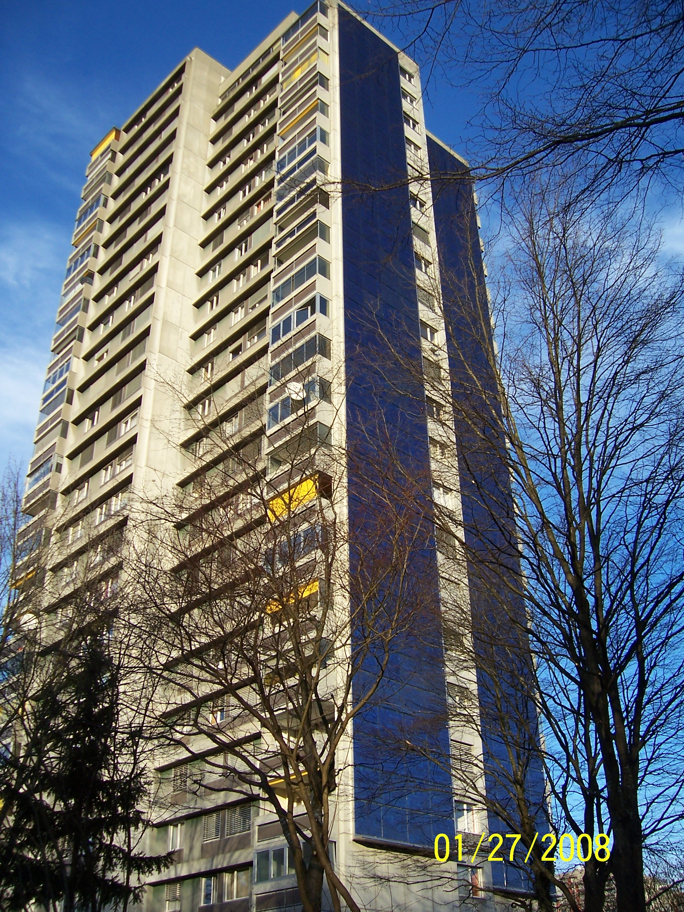

# Sustentabilidade em condomínios: por onde começar

Um plano de sustentabilidade condominial começa por medição e responsabilidades. Veja como organizar prioridades em água, energia e resíduos sem promessas vagas.

**Redação Patri Realty · Apuração em 22/10/2026 · Rascunho**

Edifício residencial com painéis solares em Berna, Suíça. Referência visual; não representa condomínio brasileiro.

Foto: Solarpow / Wikimedia Commons · Public domain · registro 2008-01-27

Origem: https://commons.wikimedia.org/wiki/File:Apartment_building_with_solar_panels.jpg · Licença: https://commons.wikimedia.org/wiki/File:Apartment_building_with_solar_panels.jpg

Sem alteração editorial. Miniatura redimensionada pelo Wikimedia Commons, quando fornecida.

## Em poucas palavras

Para começar a sustentabilidade em um condomínio, organize os consumos de água e energia, identifique perdas e estabeleça responsáveis. Depois compare intervenções com base técnica, investimento e manutenção. Painéis solares, reúso e novas instalações precisam ser avaliados para cada edifício; não são uma solução universal nem garantia de economia.

## Primeiro, saber de onde vêm os números

Nossa proposta é montar uma linha de base antes de anunciar uma meta. Reúna contas, leituras e registros de ocupação disponíveis. Separe áreas comuns de unidades privativas quando a medição permitir e documente mudanças de uso. Comparar meses com condições muito diferentes pode produzir uma impressão errada de melhora.

O plano deve dizer quem confere os dados e quem responde por desvios. Um vazamento corrigido ou uma configuração de iluminação revisada são entregas objetivas quando acompanhadas por registros. Não atribua a elas um percentual de economia sem medição que o sustente.

## Energia: eficiência antes da escolha de um equipamento

No Brasil, o PBE Edifica disponibiliza informações e tabelas de eficiência energética de edificações. A ENCE é uma referência de avaliação dentro do seu escopo; não promete o valor da próxima fatura de um condomínio. O Ministério de Minas e Energia também reúne a orientação pública sobre eficiência em edifícios. [1](https://www.gov.br/inmetro/pt-br/assuntos/regulamentacao/avaliacao-da-conformidade/programa-brasileiro-de-etiquetagem/tabelas-de-eficiencia-energetica/edificacoes)[2](https://www.gov.br/mme/pt-br/assuntos/ee/indices-minimos-de-ee/eficiencia-energetica-das-edificacoes)

Como sequência de análise, recomendamos verificar horários de uso, controles, iluminação, equipamentos e contratos. Só então compare investimentos maiores. Para geração solar, peça estudo de consumo, área disponível, sombreamento, conexão, orçamento e manutenção, com profissionais habilitados.

## Água e resíduos precisam de operação

Reúso e aproveitamento de chuva são assuntos de projeto, qualidade da água, destinação e regras locais. A legislação federal de saneamento prevê condições para fontes alternativas em determinadas situações; isso não autoriza usar água de qualquer origem para qualquer finalidade. Consulte o serviço local e a equipe técnica. [3](https://www2.camara.leg.br/legin/fed/lei/2007/lei-11445-5-janeiro-2007-549031-normaatualizada-pl.html)

Para resíduos, um roteiro prático é mapear o que se gera, confirmar o destino contratado e tornar a separação compreensível para moradores e funcionários. Sacos e lixeiras sem coleta compatível não encerram o trabalho. Estas são recomendações de implementação, sem atribuir um resultado ambiental já medido.

## Um roteiro de 90 dias para discussão

Dias 1 a 30: reunir documentos e consumos, inspecionar perdas e definir responsáveis. Dias 31 a 60: comparar propostas de intervenção e requisitos técnicos. Dias 61 a 90: executar o que estiver regularmente aprovado e acompanhar o resultado. Esse é um cronograma sugerido, ajustável à realidade do condomínio.

Apresente na assembleia as alternativas, os custos iniciais, os custos recorrentes e as incertezas. O objetivo é formar uma decisão verificável. Uma campanha de sustentabilidade fica mais confiável quando mostra também o que ainda não foi medido.

## Perguntas frequentes

### Todo condomínio é obrigado a instalar energia solar?

Não decorre das fontes desta pauta uma obrigação geral de instalação para todos os condomínios. Analise regras aplicáveis, viabilidade técnica e aprovação necessária no caso concreto.

### A etiqueta energética garante conta menor?

Não. A conta depende também do uso, da ocupação, das tarifas e da operação dos sistemas.

### Como anunciar uma redução de consumo?

Informe período, unidade de medida, área considerada e método de comparação. Sem base consistente, apresente a ação realizada e evite afirmar um resultado ainda não demonstrado.

## Verbetes

**Linha de base** — Referência de consumo ou desempenho anterior à intervenção, com período e condições documentados.

**ENCE** — Etiqueta Nacional de Conservação de Energia; seu alcance depende do objeto e da metodologia avaliados.

**Reúso** — Uso de água previamente utilizada após tratamento e controle compatíveis com a finalidade autorizada.

## Fontes consultadas em 22/10/2026

- [Inmetro — tabelas de edificações](https://www.gov.br/inmetro/pt-br/assuntos/regulamentacao/avaliacao-da-conformidade/programa-brasileiro-de-etiquetagem/tabelas-de-eficiencia-energetica/edificacoes)

- [MME — eficiência energética das edificações](https://www.gov.br/mme/pt-br/assuntos/ee/indices-minimos-de-ee/eficiencia-energetica-das-edificacoes)

- [Lei 11.445/2007 — texto atualizado](https://www2.camara.leg.br/legin/fed/lei/2007/lei-11445-5-janeiro-2007-549031-normaatualizada-pl.html)

## Continue a leitura

- [Bosco Verticale: o que avaliar em um empreendimento sustentável](bosco-verticale-empreendimentos-sustentaveis.md)

- [Gestão condominial de alto padrão: o luxo da previsibilidade](gestao-condominial-alto-padrao.md)

- [BIM e inovação: o que deve chegar à operação do condomínio](bim-construcao-inovacao-condominios.md)

## Kit de publicação

**Título SEO:** Sustentabilidade em condomínios: plano prático

**Meta description:** Um plano de sustentabilidade condominial começa por medição e responsabilidades. Veja como organizar prioridades em água, energia e resíduos sem promessas vagas.

**Slug:** sustentabilidade-condominios-plano-pratico

**Buscas:** sustentabilidade em condomínios, economia de água condomínio, eficiência energética condomínio

**Intenção:** Informacional; comparação e diligência antes da decisão

**Legenda social:** Sustentabilidade começa com uma pergunta: o que conseguimos medir? Organizamos um roteiro de água, energia e resíduos para o condomínio decidir com evidências, responsabilidades e uma conta completa.
