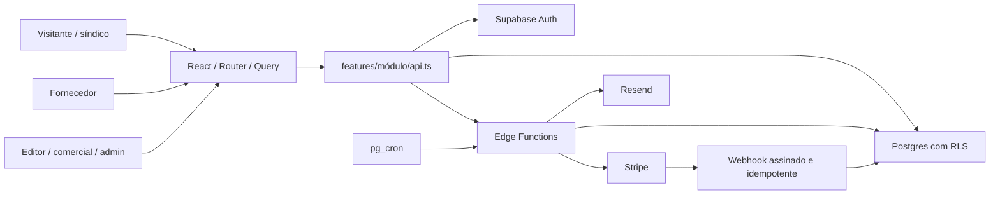

# Compreensão do produto e arquitetura

A Patri Realty é um negócio de geração de demanda B2B para condomínios. O fornecedor é responsável pelo conteúdo da própria empresa; a plataforma controla a autorização para publicação, a confiança do catálogo e a monetização do relacionamento. O síndico pode solicitar orçamento sem conta. Sua conta acrescenta histórico e avaliações. A redação e o comercial operam como áreas distintas, com privilégios limitados no banco.

## Ciclos essenciais

O primeiro ciclo é cadastro → confirmação → página rascunho → completude mínima → análise → publicação → teste Premium. A publicação é a origem dos 90 dias, não o cadastro. O segundo é busca → orçamento → regra de franquia mensal → entrega ou bloqueio → resposta → convite para avaliação. O terceiro é aquisição paga → webhook verificado → transação idempotente → benefício do plano/crédito → métricas → renovação. A redação conecta reputação e aquisição com matérias moderadas, revista e conteúdo de marca.

A empresa pode estar publicada enquanto uma alteração sensível está pendente. Portanto, sua versão pública e a proposta de edição precisam de armazenamento separado. Um campo de status na mesma linha, sozinho, não resolve essa regra. Convites e reivindicações também são processos distintos: o convite não comprova por si só a legitimidade de uma disputa de propriedade.

## Limites de confiança

O desenho acima representa o destino do projeto inteiro. Nesta entrega foram implementados UI, camada de API de autenticação, Auth e banco de fundação. Stripe, Edge Functions, Resend e cron ainda são módulos futuros.

O cliente controla apresentação; o banco controla acesso. `RequireRole` melhora a navegação, mas não protege dados sozinho. `user_roles` é a fonte dos papéis; `profiles.ativo` participa de todas as decisões privadas. Uma conta pode ter vários papéis. Apenas o cadastro livre de `sindico`/`fornecedor` é aceito pelo trigger: valores como `admin` em metadados são rejeitados.

As rotinas privilegiadas internas ficam no schema `private`, com `search_path` fixo e EXECUTE revogado de PUBLIC. A interface usa uma função pública de consulta do próprio papel. Não há chave privilegiada no frontend. Auditoria é escrita por trigger; usuários não conseguem forjar eventos de auditoria pela API.

## Contratos dos módulos futuros

- **Catálogo:** público lê somente empresas publicadas de donos ativos; busca e sitemap devem compartilhar esse filtro. O cadastro mínimo da fundação não concede leitura pública da tabela de fornecedores.
- **Página da empresa:** a fase 2 amplia a identidade mínima atual com marca, serviços, cobertura e mídias. Membros poderão editar conteúdo, sem poderes de cobrança. Não se deve simplesmente liberar UPDATE de todas as colunas ao dono.
- **Leads:** contato e mensagem precisam ficar protegidos no servidor. RLS controla linhas, não oculta colunas de leads bloqueados; usar separação de contato ou RPC/projeção segura. Borrar contato no React seria uma exposição.
- **Créditos:** débito, lançamento no extrato e desbloqueio são uma única transação com bloqueio de linha. Dois cliques simultâneos não podem gastar duas vezes nem liberar sem saldo.
- **Pagamentos:** registrar `event.id` e o benefício na mesma transação, validar valor, produto, moeda e fornecedor pelos registros internos. Nunca conceder crédito usando apenas o redirect de sucesso.
- **Planos:** limites configuráveis, mês civil definido no fuso de negócio, CNPJ com histórico de teste independente da conta. Reduzir plano oculta excedentes, preservando a possibilidade de restauração.
- **Comercial:** três vagas por segmento/UF exigem restrição temporal no banco, não só UNIQUE de datas ou validação na interface. Implementar exclusão por intervalos para impedir sobreposição.
- **Conteúdo:** saldo de matérias controlado atomicamente no servidor; agendamento e limites independem do relógio do navegador. Cortesia e franquia mensal têm vencimentos distintos.
- **Métricas:** coleta após consentimento, sem IP ou contato nos eventos, agregação diária idempotente por dimensão. Impressão exige visibilidade real do banner.
- **LGPD:** apagar conta significa anonimizar, revogar sessões e manter vínculos operacionais sem identificação. RLS precisa considerar conta desativada mesmo com JWT ainda válido.

## Frontend e SEO

Mantida a stack React 18 + Vite especificada. O formulário de autenticação é carregado sob demanda e bibliotecas grandes são separadas no build. Para a fase 3, a decisão é adotar SSR com Vite para páginas públicas dinâmicas; o portal não pode depender de atualizar um prerender manual após cada publicação. Essa camada ainda não está implementada. O build atual é SPA de desenvolvimento e não atende sozinho ao aceite de SEO do guia.

Os painéis desta entrega são estruturas de acesso autenticado. Não representam dashboards com métricas, aprovações ou CRUD implementados. As páginas legais avisam expressamente que a redação definitiva está pendente; não são documentos jurídicos finais.

## Dependências entre fases

A fase 2 depende da identidade e autorização da fase 1. A fase 3 depende de páginas de fornecedor aprováveis. Leads dependem do catálogo; a fase 6 depende tanto dos leads quanto da aprovação que inicia o teste. Conteúdo e comercial usam a mesma identidade/assinatura, mas possuem matrizes de acesso próprias. Avaliações e marketing dependem de conteúdo público e métricas. A fase 10 homologa esses ciclos juntos, incluindo os cinco fluxos críticos exigidos no documento.
