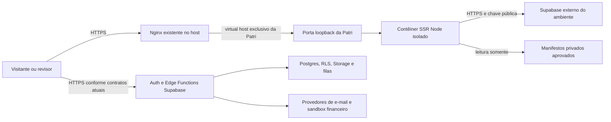

# Patri Realty — desenho de implantação no KVM 2

Versão1, 23/10/2026. **DESENHO SOMENTE; NO-GO preservado.** Nenhum comando remoto, instalação, contêiner, volume, proxy, certificado, DNS ou recurso Supabase criado/alterado. React18/Vite/TypeScript, servidor SSR Node e contratos Supabase atuais mantidos. Não há script de implantação automática nesta entrega.

## Objetivo e limites

Preparar homologação isolada no VPS existente, com Supabase externo, preservando aplicações já hospedadas. A auditoria privada de23/10 mostrou recursos aparentes suficientes ao piloto pequeno, mas também aplicações nativas, bancos e proxy em uso; ausência do Gerenciador Docker no hPanel não significa ausência de Docker. Inventário detalhado de outros projetos permanece fora do Git público.

Este documento não aprova capacidade produtiva, segurança do host ou publicação. Domínio patrirealty.com.br escolhido; última observação foi registro em andamento, sem nova consulta nesta preparação. Supabase da Patri ainda não criado. Não assumir controle de portas80/443, certificados, redes ou diretórios existentes.

## Arquitetura proposta

O navegador continua usando as APIs/gateways do projeto Supabase conforme o código atual. O desenho não pressupõe que todo tráfego passe pelo SSR: Auth/Data API/RPC/Storage precisam de proteção própria. Não instalar Postgres, MariaDB, Supabase completo, painel ou outro proxy neste VPS para a Patri.

## Isolamento e recursos

| Área | Proposta | Condição de homologação |
|---|---|---|
| Unidade | Projeto Docker exclusivo patri-realty-staging; produção futura patri-realty-prod, com nomes/redes distintos | Docker já existe; confirmar versão/Compose/cgroups sem instalar ou atualizar por inferência |
| Runtime | Node22 em patch de segurança suportado; imagem fixada por digest após build | Não fixar uma versão antiga apenas porque foi usada no laboratório; verificar compatibilidade e vulnerabilidades |
| Processo | Usuário não root, filesystem somente leitura, tmpfs limitado em /tmp, sem privilégios, sem socket Docker, sem host network/PID | Testar o runtime inteiro com essas restrições; não conceder escrita ampla para contornar falha |
| Rede | Bridge exclusiva por ambiente; sem conectar a redes das outras aplicações | Saída HTTPS/DNS necessária ao Supabase/provedores; não declarar bloqueio de egress inexistente |
| Entrada | Proposta staging127.0.0.1:15175→5175; produção futura127.0.0.1:15176→5175 | Portas são candidatas, não reservadas/livres comprovadas. Inspecionar conflitos antes de criar; não publicar em0.0.0.0/IPv6 público |
| CPU | Teto inicial proposto0,75CPU por instância | Medir SSR/hidratação/latência e vizinhos; não é reserva garantida nem capacidade aprovada |
| Memória | Teto inicial768MiB por instância; heap Node proposto384MiB; pids128 | Hipóteses de partida a testar. Heap não cobre toda memória do processo; não desabilitar OOM killer |
| Coexistência | Primeiro somente staging; produção só após capacidade e gates | Duas instâncias somam até1,5CPU/1536MiB de limites; terceira instância blue/green exige avaliação adicional |
| Build | Compilar e testar fora do VPS compartilhado | Não executar npm ci/build na máquina como parte de atualização normal; reduzir competição com serviços existentes |
| Disco | Orçamento inicial proposto≤5GiB para artefatos/logs da Patri, com alerta e limpeza aprovada | Não é quota já aplicada. Monitorar espaço/inodes; nunca docker prune global ou limpeza de volumes alheios |

A proposta não cria swap nem muda limites/firewall globais. Docker publica portas por regras próprias; confirmar versão e exposição IPv4/IPv6. Docker anterior28 tem ressalva documentada de acesso L2 a portas publicadas em localhost. Se versão/rede não garantirem isolamento, não implantar antes de solução autorizada. [Portas Docker](https://docs.docker.com/engine/network/port-publishing/) e [limites de recursos](https://docs.docker.com/engine/containers/resource_constraints/), consultados23/10/2026.

## Organização proposta no servidor

Caminhos sugeridos, ainda não criados ou inspecionados quanto a conflito:

| Caminho | Conteúdo / acesso |
|---|---|
| /opt/patri-realty/releases/BUILD_ID | Artefato imutável/digest e metadados sanitizados; sem segredos |
| /etc/patri-realty/staging.env e prod.env | Configuração privada por ambiente, root0600; nunca Git ou diretório público |
| /var/lib/patri-realty/staging/reviews e prod/reviews | Manifestos externos de revisão, leitura pelo UID do contêiner; diretório0750/arquivo0640 como proposta |
| /var/lib/patri-realty/deployments | Registro privado de versão, configuração sem valores secretos, provas e reversões |
| /var/log/patri-realty | Logs sanitizados exclusivos, rotação e retenção aprovadas; não alterar rotação global |

Dentro do contêiner: /app para artefato; /run/patri-reviews para bind mount de **diretório** privado somente leitura, fora de /app. Montar o diretório permite substituir o arquivo atomicamente no host sem prender um inode antigo por bind mount de arquivo. Caminhos configurados devem continuar absolutos e externos ao checkout segundo server.mjs. Revisões de produção não compartilham o diretório de rascunhos de staging.

Não montar todo /etc, /root, checkout privado ou diretórios de outros projetos. Não copiar .env.local, sources, histórico local, dumps, seeds, contas de teste ou rascunhos para imagem/contexto público. Backup de ambiente/manifestos exige acesso e criptografia próprios.

## Artefato e contrato de configuração

Build por ambiente com npm ci e npm run build:ssr em executor isolado; somente variáveis públicas VITE_ no build. Artefato contém dist, dist-server, server.mjs, módulos server e dependências runtime necessárias. O servidor importa Vite para loadEnv; não podar devDependencies indiscriminadamente. Caminho de trabalho /app e npm start/node server.mjs. Registrar commit, lockfile, versão Node, digest, origem e hash dos manifestos; imagem ou pacote sozinho não prova o código servido.

VITE_SITE_URL é usado no build e no runtime: gerar artefatos distintos se staging e produção tiverem origens diferentes. Evitar build padrão como frontend estático; a resposta deve vir do servidor Node. Configuração por ambiente:

- PORT=5175 dentro do contêiner; PATRI_ALLOWED_HOSTS estritamente necessário. Origem HTTPS explícita, sem path/query, nunca inferida do header recebido.
- Staging com PATRI_PREVIEW_MODE=true, senha forte privada e arquivos de revisão próprios. Sem senha válida o comportamento deve continuar fail-closed. Subdomínio sugerido previa.patrirealty.com.br é proposta, ainda não criado.
- Produção permanece sem instância pública até GO; não mudar PATRI_PREVIEW_MODE para liberar antes dos gates. Demo sem Supabase é protegida e não substitui produção.
- VITE_SUPABASE_URL e chave pública correspondentes ao ambiente; URLs Edge corretas; nenhum localhost/fixture como API real. PATRI_EDITORIAL_FIXTURES não habilitado em produção.
- SSR recebe somente chaves que usa: não distribuir service_role, Stripe secret, Resend, salts ou segredo de cron ao contêiner do site. Esses ficam nas funções/cofres dos serviços externos pertinentes.
- PATRI_LOCAL_REVIEW_FILE e PATRI_EDITORIAL_APPROVAL_FILE apontam para revisões reais vigentes, privadas; ausência não aprova nada. PATRI_EDITORIAL_REVIEW_FILE é distinto e restrito ao staging.

[Mapa completo de configuração](configuracao-destino-pt16.csv). Variáveis/flags de verificado não são evidência. O modelo JSON deste desenho contém apenas propostas, nenhum segredo ou aprovação.

## Integração futura com o Nginx existente

Antes de produzir um arquivo aplicável, inspecionar somente as seções pertinentes de server_name/listen/proxy_pass/certificados/includes e donos; não coletar configuração inteira com possíveis segredos para relatório público. Confirmar quem mantém80/443. Nenhum vhost foi lido ou modificado nesta preparação.

Adicionar, quando autorizado, somente vhost de staging exclusivo. Não substituir nginx.conf, default_server, blocos de outros domínios, PHP, bancos ou certificados existentes. Upstream aponta para a porta loopback candidata depois de validada. Host encaminhado explicitamente para a origem do ambiente; preservar Authorization para o guard de staging, Accept para negociação HTML/Markdown e Content-Type. Não confiar em X-Forwarded-Host do cliente. Excluir/normalizar headers encaminhados no limite do proxy, sem presumir que o rate limit atual lê esses campos.

Proxy sem cache no primeiro piloto; preservar Cache-Control/Vary e status401/403/404/429/503 e redirects reais. Não interceptar erros devolvendo index.html200. Não servir /assets ou /resources por alias Nginx: isso contornaria a autenticação de staging que protege também arquivos. Tudo passa pelo Node; assets imutáveis só recebem política correspondente em produção. Não usar cache com páginas privadas, cookies, tokens ou respostas autenticadas. [Diretivas oficiais de proxy](https://nginx.org/en/docs/http/ngx_http_proxy_module.html).

TLS somente depois de domínio/subdomínio e DNS confirmados; certificado exclusivo/compatível, renovação testada e sem parar o Nginx atual para challenge. Não reutilizar certificado por suposição. Não ativar HSTS includeSubDomains/preload global por inferência. Futura validação nginx -t precede qualquer reload autorizado; teste de sintaxe não é aprovação de publicação. Não reiniciar o proxy nem serviços atuais neste desenho.

Confirmar IP real e limites: o guard da prévia pode enxergar o proxy como único cliente; não resolver isso confiando em qualquer X-Forwarded-For. Testar IP/rate limit e estratégia de proxy confiável em sprint de implementação, inclusive Auth externo. Nenhuma alteração silenciosa de autenticação ou headers de segurança dos demais sites.

## Supabase externo e integrações

Staging e produção separados, na organização do titular; SãoPaulo é região candidata, condicionada à decisão e teste de latência Boston↔backend. Não criar projeto ou contratar plano nesta etapa. SupabasePro é opção econômica somente se proteção equivalente ao requisito de login for homologada; hook Password Verification Attempt previsto no código exige plano hospedado compatível. Não afirmar que gateway sozinho impede Auth direto.

Antes de aplicar migrations: auditar versão, extensões, grants/RLS/RPC/Storage e cron; impedir publicação/agendamentos editoriais até aprovação por versão também no backend. O worker e-mail já foi desacoplado no código e a Edge editorial bloqueada, mas RPC/crons históricos continuam pendentes. Não carregar seed de demonstração. SMTP Auth, Resend da aplicação, Turnstile e sandbox financeiro são contratos separados, com testes controlados. Nenhum worker ativado para simples teste de envio, pois ainda prepara outras rotinas.

## Saúde, logs, backups e observabilidade

Sem novo endpoint /health presumido. Em staging, um probe sem credenciais na rota protegida deve receber401 com headers esperados;503 por senha ausente/fraca é falha, nunca saúde. Isso prova processo/guard, não backend. Separar teste autenticado autorizado com conteúdo esperado e consultas externas controladas; credenciais do probe nunca em linha de comando, logs ou Git. Docker unhealthy não reinicia por si só; definir política de recuperação com responsável antes de ativar, sem loop de restart.

Produção futura: robots/sitemap/status/SSR e conteúdo esperado por URL, backend, formulário/recibo/persistência, filas, e-mail e logs. Não usar apenas TCP aberto ou HTTP200 como prova. Nenhum monitor/agendamento configurado.

Log mínimo proposto: data, ambiente, build, request-id gerado na borda, status, duração e bytes; não registrar query, corpo, Authorization, cookies, e-mail, IP livre, referer ou caminho contendo token. Revisar também logs de erro do proxy, que podem capturar URI. Inicialmente access log de staging desligado ou sanitizado em arquivo exclusivo; não modificar logs dos demais serviços. Retenção/alertas/destinatários e escala de resposta dependem de responsáveis nomeados e política aprovada.

Preservar imagem/artefato e manifesto anteriores homologados, configuração privada, evidências e inventário. Backup semanal do VPS não substitui backup da aplicação, revisões e backend. Banco e arquivos Storage do Supabase exigem planos distintos de cópia/restore; reaplicar exclusões após restauração isolada. Definir RPO/RTO com titular antes de GO, sem números prometidos. Testar recuperação antes da liberação; não restaurar o VPS inteiro para reverter uma aplicação.

## Sequência de implantação futura — não executada

| Etapa | Objetivo/áreas | Execução e QA | Dependência / aceite |
|---|---|---|---|
| A — completar pré-verificação | Host, Docker, SO, proxy, capacidade e donos | Ler versões, cgroups, portas/rotas e criticidade; baseline7dias disponível e amostra real; verificar backups/segurança | Aprovação concreta do ambiente/mudanças; sem alterar serviços para descobrir |
| B — preparar artefato | Build e pacote por ambiente | Build/typagem/lint/testes; varredura de segredos e rascunhos; execução não root com filesystem restrito | Digest e configuração revisáveis; nenhum upload automático |
| C — homologação local futura | Contêiner e porta loopback | Uma instância staging, sem DNS público inicialmente; provar guard401/503 e acesso autenticado autorizado; conferir exposição externa negativa | Autorização de implantação; preservação dos vizinhos; rollback pronto |
| D — staging HTTPS | Vhost/TLS/DNS | Diff aditivo revisado, sintaxe, reload autorizado e regressão dos serviços atuais; TLS, host, assets, rate limits, logs | Domínio ativo e autorização específica do diff; staging protegido |
| E — backend/fluxos | Supabase e provedores | Política backend equivalente; contas/destinatários/sandbox autorizados; QAPT16 e dados mínimos | Serviços disponíveis, provas e responsáveis; sem cobranças reais |
| F — produção/piloto | Artefato, vhost e manifesto | Todas as URLs elegíveis, SSR/SPA/API/sitemap, rollback e monitoramento | GO e autorização explícita de destino/lote; staging continua protegido |

Porta, arquivos e limites são sugestões condicionais. As ações C/D/F alteram o ambiente e exigem uma próxima autorização concreta; não estão autorizadas pela solicitação de desenho. Se houver conflito, pressão de memória/CPU, OOM, erros novos dos vizinhos ou perda de proteção, não prosseguir e revisar o plano.

## Atualização e reversão

Não usar git pull+build sobre uma pasta servida. Preparar release imutável fora do tráfego, validar digest/configuração e revisão atual. Troca por candidato em porta alternativa só se houver capacidade adicional aprovada; sem essa prova, planejar janela pequena da Patri em vez de presumir zero downtime. Não parar a outra aplicação para liberar recursos.

Antes de uma troca autorizada, registrar upstream/digest/configuração/manifestos e QA dos vizinhos. Em falha, retirar somente rota/instância da Patri afetada e restaurar upstream/artefato previamente homologados compatíveis com o banco atual. Revalidar guard, status, APIs, sitemap e conteúdo. Não restaurar aprovação expirada, rascunho ou permissão antiga. Nenhum rollback automático de banco, migration down, prune global, restart Docker ou restore integral do VPS. Caches da Patri apenas, quando existirem; nginx sem cache reduz essa superfície inicial.

## Aceite deste desenho

Arquitetura, isolamento, áreas, QA, dependências e resultado esperado documentados; nenhum plano equivalente a GO. Faltam inspeção do proxy, versões/segurança, benchmark do artefato sob limites, latência, backend, direitos/oferta e autorização do lote. Os limites são hipóteses, não resultados medidos. Próxima etapa recomendada: completar pré-verificação readonly e produzir o diff de implantação de staging para revisão. Não há instalação ou mudança remota nesta entrega.
